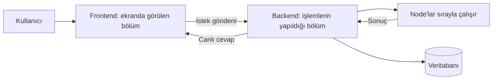

# KAI-Flow Kodlarını Anlama Rehberi

Bu rehber, KAI-Flow projesini daha önce hiç görmemiş birinin kodları adım adım anlayabilmesi için
hazırlandı. Yazılım mimarisi terimlerini bildiğinizi varsaymıyorum. Bir teknik terim kullanmam
gerektiğinde önce ne anlama geldiğini açıklayacağım.

Amacımız bütün dosyaları ezberlemek değil. Rehberin sonunda şu sorulara cevap verebilmeniz yeterli:

1. Kullanıcının ekranda çizdiği akış nerede saklanıyor?
2. Kullanıcı “Çalıştır” düğmesine basınca arka planda neler oluyor?
3. Ekrandaki kutular, yani node'lar, nereden geliyor?
4. Bir hata olduğunda hangi dosyadan araştırmaya başlamak gerekiyor?

## Önce projeyi çok basit şekilde düşünelim

KAI-Flow, kullanıcının yapay zekâ işlemlerini kutuları birbirine bağlayarak hazırladığı bir
uygulamadır.

Örneğin kullanıcı şu akışı oluşturabilir:

```text
Başla
  ↓
Kullanıcının sorusunu al
  ↓
OpenAI modeline gönder
  ↓
Cevabı göster
```

Ekrandaki her kutuya **node** denir. İki kutu arasındaki çizgiye ise **edge** denir.

Projeyi bir restoran gibi düşünebiliriz:

- `client/`, müşterinin gördüğü salon ve menüdür.
- `backend/`, siparişlerin hazırlandığı mutfaktır.
- PostgreSQL veritabanı, siparişlerin ve tariflerin saklandığı kayıt defteridir.
- Node'lar, mutfaktaki farklı çalışanlardır. Biri metin alır, biri yapay zekâyı çağırır, biri
  belge arar, biri sonucu kullanıcıya verir.
- `widget/`, restoranın hizmetini başka bir internet sitesinde kullanmayı sağlayan küçük bir
  penceredir.



## Sık karşılaşacağınız kelimeler

Kodları okumaya başlamadan önce şu kelimeleri bilmek işinizi kolaylaştırır:

| Kelime | Basit anlamı |
|---|---|
| Frontend | Kullanıcının tarayıcıda gördüğü ekranlar |
| Backend | Ekrandan gelen istekleri işleyen sunucu kodu |
| API | Frontend ile backend'in konuştuğu kapılar |
| Endpoint | API içindeki belirli bir adres; örneğin `/workflows` |
| Database / veritabanı | Kullanıcıların, workflow'ların ve sonuçların kalıcı olarak saklandığı yer |
| Workflow | Kullanıcının hazırladığı işlem akışı |
| Node | Workflow içindeki tek bir işlem kutusu |
| Edge | İki node arasındaki bağlantı çizgisi |
| Service | Asıl iş kurallarını çalıştıran kod katmanı |
| Model | Veritabanındaki bir tablonun Python kodundaki karşılığı |
| Schema | Gelen veya giden bilginin hangi alanları taşıyacağını belirleyen kontrol kalıbı |
| State | Workflow çalışırken oluşan geçici bilgiler ve sonuçlar |
| SSE | Backend sonucunun parça parça, canlı biçimde ekrana gönderilmesi |
| Registry | Sistemde kullanılabilen node türlerinin listesi |
| LangGraph | Node'ların hangi sırayla çalışacağını yöneten kütüphane |

Bu kelimelerin tamamını hemen öğrenmeniz gerekmiyor. Kod içinde karşılaştıkça tabloya geri
dönebilirsiniz.

## Projedeki ana klasörler

İlk olarak yalnızca ana klasörleri tanıyın:

```text
KAI-Flow/
├── client/          Kullanıcının gördüğü ana web uygulaması
├── backend/         API, iş kuralları ve workflow çalıştırma kodları
├── widget/          Başka sitelere eklenebilen sohbet penceresi
├── export-docker/   Hazır workflow'ları başka ortama taşıma paketi
├── docs/            Proje dokümanları
├── docker-compose.yml
└── .env.example
```

Şimdilik alt klasörlerin tamamını incelemeyin. Önce sistemde bir bilginin nasıl hareket ettiğini
öğreneceğiz.

## 1. Adım — Projenin nasıl çalıştırıldığını anlayın

Önce şu dosyalara bakın:

1. [README.md](../README.md)
2. [docker-compose.yml](../docker-compose.yml)
3. [.env.example](../.env.example)

### Bu dosyalar ne anlatıyor?

`README.md`, projenin ne yaptığını ve nasıl kurulacağını anlatır.

`docker-compose.yml`, projeyi oluşturan üç ana servisi birlikte çalıştırır:

- `db`: PostgreSQL veritabanı,
- `kai-flow-backend`: Python ile yazılmış sunucu,
- `kai-flow-frontend`: React ile yazılmış web ekranı.

`.env.example`, projenin ihtiyaç duyduğu ayarların örneğidir. Burada veritabanı adresi, portlar,
güvenlik anahtarları ve Keycloak gibi servislerin ayarları bulunur.

### Bu adımın sonunda bilmeniz gerekenler

- Frontend varsayılan olarak `http://localhost:23058` adresinde açılır.
- Backend dokümantasyonu varsayılan olarak `http://localhost:23056/docs` adresindedir.
- Veritabanı PostgreSQL'dir.
- `.env` dosyası gerçek şifreler içerebilir ve Git'e eklenmemelidir.

## 2. Adım — Kullanıcının gördüğü ekranın nereden başladığını bulun

Frontend'in başlangıç dosyalarını şu sırayla okuyun:

1. [client/app/main.tsx](../client/app/main.tsx)
2. [client/app/App.tsx](../client/app/App.tsx)
3. [client/app/routes/canvas.tsx](../client/app/routes/canvas.tsx)

### `main.tsx` ne yapıyor?

Bu dosya React uygulamasını başlatır. Çok basit biçimde görevi şudur:

```text
HTML sayfasındaki root alanını bul
  ↓
React uygulamasını buraya yerleştir
  ↓
App bileşenini çalıştır
```

### `App.tsx` ne yapıyor?

Uygulamadaki sayfaların adreslerini belirler:

| Adres | Ekran |
|---|---|
| `/` | Ana sayfa |
| `/workflows` | Workflow listesi |
| `/canvas` | Workflow tasarlama ekranı |
| `/executions` | Daha önce çalıştırılmış işlemler |
| `/credentials` | API anahtarları ve servis bilgileri |
| `/variables` | Değişkenler |
| `/marketplace` | Hazır workflow şablonları |

`App.tsx` ayrıca tema ve Keycloak ile giriş gibi genel özellikleri başlatır.

### `canvas.tsx` ne yapıyor?

Bu sayfa, asıl workflow editörü olan `FlowCanvas` bileşenini ekrana yerleştirir.

Bu adımın sonunda şu yolu açıklayabilmelisiniz:

```text
main.tsx → App.tsx → /canvas → FlowCanvas
```

## 3. Adım — Canvas'ın ne sakladığını anlayın

Ana dosya:

[client/app/components/canvas/FlowCanvas.tsx](../client/app/components/canvas/FlowCanvas.tsx)

Bu dosya oldukça büyüktür. Baştan sona okumaya çalışmayın. İlk turda yalnızca şu kelimeleri
dosya içinde arayın:

- `onDrop`: Kullanıcı yeni bir node'u ekrana bıraktığında çalışır.
- `onConnect`: Kullanıcı iki node'u çizgiyle bağladığında çalışır.
- `handleSave`: Kullanıcı workflow'u kaydettiğinde çalışır.
- `handleStartNodeExecution`: Kullanıcı workflow'u çalıştırdığında çalışır.

### Canvas verisi nasıl görünür?

Canvas, workflow'u iki liste halinde tutar:

```json
{
  "nodes": [
    {
      "id": "node-123",
      "type": "OpenAINode",
      "position": { "x": 100, "y": 200 },
      "data": { "model": "gpt-4o" }
    }
  ],
  "edges": [
    {
      "source": "node-1",
      "target": "node-2"
    }
  ]
}
```

Burada:

- `nodes`, ekrandaki kutulardır.
- `edges`, kutular arasındaki çizgilerdir.
- `id`, o kutuya özel benzersiz kimliktir.
- `type`, kutunun hangi işi yapacağını belirleyen node türüdür.
- `position`, kutunun ekrandaki yeridir.
- `data`, kullanıcının node için girdiği ayarlardır.

Bu yapının proje içindeki adı `flow_data`dır.

### `id` ve `type` neden farklıdır?

Aynı workflow içinde iki tane OpenAI node'u bulunabilir. İkisinin de `type` değeri
`OpenAINode` olur; fakat farklı kutular oldukları için `id` değerleri farklıdır.

Şöyle düşünebilirsiniz:

- `type`: Çalışanın mesleği, örneğin “garson”.
- `id`: O çalışanın kimliği, örneğin “Garson 17”.

## 4. Adım — Workflow'un nasıl kaydedildiğini takip edin

Kullanıcı “Kaydet” düğmesine bastığında bilgi birkaç katmandan geçer:

```text
FlowCanvas
  ↓
Zustand store
  ↓
Frontend service
  ↓
Backend API
  ↓
Backend service
  ↓
PostgreSQL
```

Bunu bir kargo zinciri gibi düşünebilirsiniz:

- `FlowCanvas`, paketi hazırlar.
- Store, paketin uygulama içindeki durumunu takip eder.
- Frontend service, paketi doğru API adresine gönderir.
- Backend API, paketin doğru biçimde gelip gelmediğini kontrol eder.
- Backend service, kayıt kurallarını uygular.
- Model, bilginin veritabanında nereye yazılacağını gösterir.

Şu dosyaları sırayla açın:

1. [FlowCanvas.tsx](../client/app/components/canvas/FlowCanvas.tsx) içindeki `handleSave`
2. [client/app/stores/workflows.ts](../client/app/stores/workflows.ts)
3. [client/app/services/workflows.ts](../client/app/services/workflows.ts)
4. [backend/app/api/workflows.py](../backend/app/api/workflows.py)
5. [backend/app/services/workflow_service.py](../backend/app/services/workflow_service.py)
6. [backend/app/models/workflow.py](../backend/app/models/workflow.py)

En son dosyada şu alanı göreceksiniz:

```text
flow_data = JSONB
```

Bu, canvas'taki node ve edge bilgilerinin PostgreSQL içinde JSON biçiminde saklandığı anlamına
gelir.

### Bu adımın küçük alıştırması

Bir workflow'a node eklediğinizi düşünün. Şu soruların cevaplarını bulun:

1. Node önce hangi React state'ine ekleniyor?
2. `handleSave` hangi veriyi hazırlıyor?
3. Frontend hangi API adresine istek gönderiyor?
4. Backend hangi model üzerinden veritabanına yazıyor?

## 5. Adım — Ekrandaki node'ların nereden geldiğini anlayın

Node listesi frontend içinde sabit olarak yazılmamıştır. Backend, kullanılabilir node'ları bulur
ve frontend'e bildirir.

Akış şöyledir:

```text
Backend açılır
  ↓
Node dosyalarını tarar
  ↓
Bulduğu node türlerini registry listesine ekler
  ↓
Frontend /nodes API adresinden listeyi alır
  ↓
Sol menüde node'ları gösterir
```

Okuma sırası:

1. [backend/app/nodes/base.py](../backend/app/nodes/base.py)
2. [backend/app/core/node_registry.py](../backend/app/core/node_registry.py)
3. [backend/app/api/nodes.py](../backend/app/api/nodes.py)
4. [client/app/services/nodes.ts](../client/app/services/nodes.ts)
5. [client/app/stores/nodes.ts](../client/app/stores/nodes.ts)
6. [client/app/components/common/Sidebar.tsx](../client/app/components/common/Sidebar.tsx)

### `base.py` neden önemli?

Her node aynı temel kurallara uymalıdır. `base.py`, bu ortak kuralları tanımlar.

Bir node kabaca şu bilgileri verir:

- adı,
- ekranda gösterilecek adı,
- açıklaması,
- kategorisi,
- hangi bilgileri aldığı,
- hangi bilgileri ürettiği,
- ayar formunda hangi alanların gösterileceği.

Örneğin bir OpenAI node'u model adı, sıcaklık değeri ve credential seçimi isteyebilir. Backend bu
alanları tarif eder; frontend de bu tarife bakarak formu otomatik oluşturur.

Formu oluşturan ana dosya:

[client/app/components/node/GenericNodeForm.tsx](../client/app/components/node/GenericNodeForm.tsx)

Bu nedenle çoğu yeni node için özel bir frontend formu yazmak gerekmez.

## 6. Adım — Node türlerini basitçe ayırın

Node'lar çalışma şekillerine göre dört gruba ayrılır:

### Provider node

Başka node'ların kullanacağı bir araç hazırlar.

Örnekler:

- OpenAI modeli hazırlar,
- embedding modeli hazırlar,
- Tavily arama aracını hazırlar.

Bunu mutfakta kullanılan bir cihazı hazırlamak gibi düşünebilirsiniz.

### Processor node

Gelen bilgiyi gerçekten işler.

Örnekler:

- Agent çalıştırır,
- koşulu kontrol eder,
- metni parçalara böler,
- Python kodu çalıştırır.

### Terminator node

Akışın başlangıç, bitiş veya dış dünyayla bağlantı noktasında görev alır.

Örnekler:

- Start node,
- End node,
- Webhook trigger,
- Timer trigger.

### Memory node

Önceki konuşmaları hatırlamak için kullanılır.

Örnek: `BufferMemoryNode`.

İlk turda bu sınıfların kod ayrıntılarını öğrenmeniz gerekmez. Yalnızca bir node'u gördüğünüzde
hangi gruba ait olduğunu anlamaya çalışın.

## 7. Adım — Backend'in nasıl başladığını anlayın

Backend'in başlangıç dosyası:

[backend/main.py](../backend/main.py)

Bu dosya açılış sırasında şu işleri yapar:

```text
Log sistemini hazırla
  ↓
Node dosyalarını bul
  ↓
Workflow motorunu hazırla
  ↓
Veritabanına bağlanmayı dene
  ↓
API adreslerini aç
  ↓
Kafka dinleme görevini başlat
```

### Router nedir?

Backend'deki API adresleri konuya göre farklı dosyalara ayrılır. Bu dosyalara router denir.

Örnekler:

- `api/workflows.py`: workflow işlemleri,
- `api/executions.py`: çalışma kayıtları,
- `api/chat.py`: sohbet işlemleri,
- `api/credentials.py`: credential işlemleri,
- `api/documents.py`: belge işlemleri.

`main.py`, bu router'ları ana FastAPI uygulamasına ekler.

Tüm endpoint'leri ezberlemeye çalışmayın. İhtiyaç duyduğunuzda [API dokümanına](api.md) veya
çalışan backend'in `/docs` sayfasına bakın.

## 8. Adım — “Çalıştır” düğmesine basılınca ne olduğunu anlayın

Bu, projenin en önemli akışıdır.

Kullanıcı workflow'u çalıştırdığında şu olaylar gerçekleşir:

```text
1. Frontend node ve edge listesini hazırlar.
2. Backend'e “bu workflow'u çalıştır” isteği gönderir.
3. Backend kullanıcıyı ve workflow'u kontrol eder.
4. Veritabanında bir execution kaydı oluşturur.
5. Node bağlantılarını çalıştırılabilir bir grafiğe çevirir.
6. Node'ları doğru sırayla çalıştırır.
7. Her adımın durumunu canlı olarak frontend'e gönderir.
8. Sonucu ve çalışma durumunu veritabanına kaydeder.
```

Bu akışı şu dosyalardan takip edin:

1. [FlowCanvas.tsx](../client/app/components/canvas/FlowCanvas.tsx) içindeki
   `handleStartNodeExecution`
2. [client/app/services/executionService.ts](../client/app/services/executionService.ts) içindeki
   `executeWorkflowStream`
3. [backend/app/api/workflows.py](../backend/app/api/workflows.py) içindeki
   `execute_adhoc_workflow`
4. [backend/app/services/workflow_executor.py](../backend/app/services/workflow_executor.py)
5. [backend/app/core/workflow_enhancer.py](../backend/app/core/workflow_enhancer.py)
6. [backend/app/core/dynamic_workflow_engine.py](../backend/app/core/dynamic_workflow_engine.py)
7. [backend/app/core/graph_builder/__init__.py](../backend/app/core/graph_builder/__init__.py)
8. [backend/app/core/graph_builder/node_executor.py](../backend/app/core/graph_builder/node_executor.py)

### Bu kadar çok dosya neden var?

Her dosyanın farklı bir sorumluluğu vardır:

| Dosya | Basit görevi |
|---|---|
| `workflows.py` API | İsteği alır ve erişimi kontrol eder |
| `workflow_executor.py` | Çalıştırma işleminin tamamını yönetir |
| `workflow_enhancer.py` | Bu çalışma için yeni bir motor hazırlar |
| `dynamic_workflow_engine.py` | Workflow'u çalıştırılabilir hâle getirir |
| `GraphBuilder` | Node ve edge listesini LangGraph grafiğine çevirir |
| `NodeExecutor` | Tek tek node'ları çalıştırır |

### Neden iki farklı engine dosyası var?

Projede hem `engine.py` hem de `dynamic_workflow_engine.py` bulunur. Bu durum ilk bakışta kafa
karıştırabilir.

- `engine.py`, genel workflow motoru arayüzünü tanımlar ve backend açılırken hazırlanır.
- Canvas'tan yapılan normal test çalıştırmaları bugün `workflow_enhancer.py` üzerinden yeni bir
  `DynamicWorkflowEngine` oluşturur.
- Her iki yol da en altta `GraphBuilder` altyapısını kullanır.

Başlangıçta bunun neden tarihsel olarak ikiye ayrıldığını çözmeye çalışmayın. Bilmeniz gereken
şudur: Canvas'taki çalıştırma hatasını araştırırken önce `WorkflowExecutor` ve dynamic engine
yolunu takip edin.

## 9. Adım — Canlı sonuçların ekrana nasıl döndüğünü anlayın

Workflow çalışırken kullanıcı node'ların sırayla renklendiğini ve çıktının canlı geldiğini görür.
Bu işlem SSE adı verilen yöntemle yapılır.

SSE'yi canlı radyo yayını gibi düşünebilirsiniz:

- Normal API cevabında backend bütün işin bitmesini bekler ve tek cevap gönderir.
- SSE'de backend, işlem devam ederken küçük mesajlar gönderir.

Gönderilen temel mesajlar şunlardır:

| Mesaj | Anlamı |
|---|---|
| `start` | Workflow çalışmaya başladı |
| `node_start` | Belirli bir node çalışmaya başladı |
| `node_end` | Node çalışmasını tamamladı |
| `token` | Yapay zekâ cevabından yeni bir metin parçası geldi |
| `complete` | Workflow tamamlandı |
| `error` | Bir hata oluştu |

Frontend bu mesajlara göre node renklerini, çizgi animasyonlarını ve sonuç alanını günceller.

Bu nedenle backend'deki mesaj biçimi değiştirilirse frontend de güncellenmelidir.

## 10. Adım — Workflow çalışırken bilgiler nerede tutuluyor?

Ana dosya:

[backend/app/core/state.py](../backend/app/core/state.py)

Workflow çalışırken node'ların birbirine aktaracağı bilgiler `FlowState` içinde tutulur.

FlowState'i bir kuryenin taşıdığı dosya çantası gibi düşünün. Her node:

1. Çantadaki gerekli bilgiyi okur.
2. Kendi işini yapar.
3. Sonucunu çantaya ekler.
4. Çantayı sonraki node'a bırakır.

Çantadaki önemli bilgiler:

- kullanıcının ilk girdisi,
- son üretilen çıktı,
- hangi node'ların çalıştığı,
- her node'un ürettiği sonuç,
- oluşan hatalar,
- kullanıcı, workflow ve oturum kimliği.

Birden fazla dal aynı anda çalışabiliyorsa sonuçların güvenli biçimde birleştirilmesi gerekir.
`merge_node_outputs`, `merge_executed_nodes` ve `merge_errors` fonksiyonları bu işi yapar.

## 11. Adım — Veritabanını anlamak

KAI-Flow, kalıcı bilgileri PostgreSQL içinde tutar.

Başlangıç için şu dosyaları okuyun:

1. [docs/database.md](database.md)
2. [backend/app/models/MODELS.md](../backend/app/models/MODELS.md)
3. [backend/migrations/database_setup.py](../backend/migrations/database_setup.py)

Tabloları görevlerine göre düşünebilirsiniz:

| Bilgi | Örnek tablolar |
|---|---|
| Kullanıcı ve organizasyon | `users`, `organization` |
| Workflow | `workflows`, `workflow_templates` |
| Çalıştırma kayıtları | `workflow_executions` |
| Sohbet ve hafıza | `chat_message`, `memories` |
| Credential | `user_credentials` |
| Belge ve RAG | `documents`, `document_chunks`, `vector_documents` |
| Zamanlanmış işler | `scheduled_jobs`, `job_executions` |
| Webhook | `webhook_endpoints`, `webhook_events` |

Bu projede veritabanı değişiklikleri için aktif bir Alembic migration dizini yoktur.
`database_setup.py`, tabloları modellerden oluşturur ve beklenen tabloları kontrol eder.

Başlangıç seviyesinde sadece şu ilişkiyi bilmeniz yeterlidir:

```text
Model dosyası → Veritabanı tablosu
Service → Bu tablo üzerinde yapılan işlemler
Schema → API'ye giren ve API'den çıkan bilgi biçimi
```

## 12. Adım — Kullanıcı girişi ve credential farkı

İki farklı güvenlik bilgisini karıştırmamak önemlidir.

### Kullanıcı girişi

Kullanıcının KAI-Flow'a giriş yapmasını sağlar. Projede iki yol vardır:

- KAI-Flow'un kendi JWT giriş sistemi,
- Keycloak üzerinden kurumsal giriş.

Başlangıç dosyaları:

- [backend/app/auth/dependencies.py](../backend/app/auth/dependencies.py)
- [backend/app/core/security.py](../backend/app/core/security.py)
- [client/app/stores/auth.ts](../client/app/stores/auth.ts)

### Credential

Workflow içindeki OpenAI, Tavily veya başka servislerin API anahtarlarıdır. Kullanıcının uygulamaya
giriş şifresiyle aynı şey değildir.

Credential bilgileri veritabanında şifrelenerek saklanır. Şifreleme için
`CREDENTIAL_MASTER_KEY` kullanılır. Bu anahtar kaybedilirse saklanmış credential değerleri geri
açılamaz.

## 13. Adım — AI Builder'ı anlamak

AI Builder, kullanıcının yazdığı doğal dil açıklamasından otomatik workflow üretir.

Örnek istek:

> Belgelerimde arama yapan ve cevabı OpenAI ile hazırlayan bir asistan oluştur.

Sistem bunu kabaca şöyle işler:

```text
Kullanıcının isteğini al
  ↓
Hangi node'ların gerektiğini belirle
  ↓
Node'ları ve bağlantıları oluştur
  ↓
Node ayarlarını doldur
  ↓
Workflow'un geçerli olup olmadığını kontrol et
  ↓
Node'ları ekranda düzenli yerleştir
```

Ana dosya:

[backend/app/services/ai_builder/orchestrator.py](../backend/app/services/ai_builder/orchestrator.py)

Yardımcı dosyalar:

- `schema_compiler.py`: Kullanılabilir node bilgilerini hazırlar.
- `validator.py`: Üretilen workflow'u kontrol eder.
- `hydrator.py`: Eksik varsayılan değerleri doldurur.
- `layout_engine.py`: Node'ların ekrandaki yerlerini hesaplar.
- `diff_engine.py`: Var olan workflow'da nelerin değiştiğini bulur.

## 14. Adım — RAG akışını anlamak

RAG, yapay zekânın yalnızca genel bilgisiyle değil, kullanıcının belgeleriyle de cevap vermesini
sağlayan yöntemdir.

KAI-Flow'daki basit RAG zinciri:

```text
Belgeyi yükle
  ↓
Belgeyi küçük parçalara böl
  ↓
Parçaları sayısal vektörlere çevir
  ↓
PostgreSQL + pgvector içinde sakla
  ↓
Kullanıcının sorusuna yakın parçaları bul
  ↓
Bulunan bilgileri yapay zekâya ver
  ↓
Cevabı üret
```

İlgili node'lar:

- `DocumentLoaderNode`,
- `ChunkSplitterNode`,
- `OpenAIEmbeddingsProvider`,
- `VectorStoreOrchestrator`,
- `RetrieverProvider`,
- isteğe bağlı `CohereRerankerNode`,
- cevabı hazırlayan agent veya LLM node'u.

İlk turda vektör matematiğini öğrenmeniz gerekmez. Her node'un zincirde hangi görevi yaptığını
anlamanız yeterlidir.

## 15. Adım — Webhook, timer ve Kafka'yı anlamak

Normal workflow'u kullanıcı düğmeye basarak başlatır. Trigger node'ları ise workflow'u bir olay
olduğunda otomatik başlatır.

| Trigger | Ne zaman çalışır? |
|---|---|
| Webhook | Dış bir sistem belirli internet adresine istek gönderdiğinde |
| Timer | Belirlenen zaman geldiğinde |
| Kafka | Kafka üzerinden yeni mesaj geldiğinde |
| Error trigger | Başka bir workflow hata verdiğinde |

Başlangıç klasörü:

[backend/app/nodes/triggers/](../backend/app/nodes/triggers)

Webhook ve Kafka dosyaları yalnızca node kodu içermez. API adresleri ve arka planda çalışan
dinleyiciler de bu dosyalarda bulunur. Bu yüzden bu dosyalarda değişiklik yaparken `main.py` ile
bağlantılarını da kontrol edin.

## 16. Adım — Widget'ı anlamak

`widget/`, KAI-Flow sohbet ekranının başka internet sitelerine eklenebilmesini sağlar.

Örnek kullanım:

```text
Bir e-ticaret sitesi
  ↓
Sayfanın sağ altında KAI-Flow chat widget'ı
  ↓
Kullanıcı soru sorar
  ↓
Widget backend'e istek gönderir
  ↓
Workflow çalışır ve cevap döner
```

Başlangıç dosyaları:

1. [widget/src/KaiChatWidget.tsx](../widget/src/KaiChatWidget.tsx)
2. [widget/src/embed.tsx](../widget/src/embed.tsx)
3. [widget/src/config.ts](../widget/src/config.ts)
4. [widget/WIDGET.md](../widget/WIDGET.md)

Paketin eski isimlendirmeden kalan adı `@kaifusion/widget` şeklindedir.

## Bir hata olduğunda hangi dosyadan başlamalıyım?

| Sorun | İlk bakılacak yer |
|---|---|
| Sayfa açılmıyor | `client/app/App.tsx`, route dosyası, tarayıcı konsolu |
| Workflow kaydedilmiyor | `FlowCanvas.handleSave` → workflows store → workflows API |
| Node sol menüde görünmüyor | node class → node registry → `/nodes` API → nodes store |
| Node formu yanlış | node metadata → `GenericNodeForm.tsx` |
| Workflow başlamıyor | `execute_adhoc_workflow` → `WorkflowExecutor` |
| Belirli bir node çalışmıyor | `NodeExecutor` → node'un `execute()` metodu |
| Node rengi yanlış kalıyor | backend SSE mesajı → `FlowCanvas` event işleme kodu |
| Sohbet geçmişi kayboluyor | chat service → memory service → `session_id` |
| Credential bulunamıyor | credential service → encryption → credential provider |
| Belge araması kötü | loader → splitter → embeddings → retriever |
| Zamanlanmış iş çalışmıyor | timer API/service → trigger node |
| Kafka mesajı gelmiyor | Kafka listener → reconciliation loop |

## Hata araştırırken kullanabileceğiniz basit yöntem

Bir sorunla karşılaştığınızda rastgele dosya değiştirmeyin. Şu sırayı takip edin:

1. Sorunun oluştuğu en küçük örneği hazırlayın.
2. Frontend gerçekten istek gönderiyor mu kontrol edin.
3. İstek doğru API adresine gidiyor mu kontrol edin.
4. Backend loglarında isteği görüyor musunuz kontrol edin.
5. Execution kaydı oluşmuş mu kontrol edin.
6. Workflow hazırlanırken mi, node çalışırken mi hata olduğunu ayırın.
7. Hangi node'un son başarılı node olduğunu bulun.
8. O node'un girdisini ve çıktısını inceleyin.
9. Backend doğru sonucu gönderiyorsa frontend'in mesajı doğru işleyip işlemediğini kontrol edin.
10. Düzeltmeden sonra aynı küçük örneği tekrar çalıştırın.

Yararlı kontrol yerleri:

- Backend API ekranı: `/docs`
- Sistem sağlık kontrolü: `/health`
- Frontend log paneli
- Backend terminal logları
- Executions sayfası
- Kullanılıyorsa LangSmith kayıtları

## İlk hafta için kolay öğrenme planı

### 1. gün — Büyük resmi anlayın

- README, ana klasörler ve Docker Compose dosyasını inceleyin.
- Frontend, backend ve veritabanının görevlerini kendi cümlelerinizle yazın.
- `main.tsx → App.tsx → Canvas` yolunu takip edin.

### 2. gün — Bir workflow'u takip edin

- Canvas'a iki node ekleyin ve bağlayın.
- `flow_data` içindeki node ve edge listesini inceleyin.
- Kaydetme zincirini frontend'den veritabanına kadar takip edin.

### 3. gün — Node sistemini anlayın

- Basit bir node dosyası seçin.
- Adını, girdilerini, çıktılarını ve `execute()` bölümünü bulun.
- Bu node'un frontend formunun metadata'dan nasıl oluştuğunu takip edin.

### 4. gün — Workflow çalıştırmayı anlayın

- Basit bir workflow'u çalıştırın.
- `node_start`, `node_end` ve `complete` mesajlarını takip edin.
- Execution kaydındaki sonuçla canvas'taki sonucu karşılaştırın.

### 5. gün — Bir alan seçin

İlginize göre şu alanlardan yalnızca birini seçin:

- AI Builder,
- RAG,
- webhook/timer/Kafka,
- widget,
- auth ve credentials.

Ana sistemi anlamadan bütün alanları aynı anda öğrenmeye çalışmayın.

## İlk aşamada okumayı erteleyebileceğiniz dosyalar

Aşağıdaki alanlar önemlidir; fakat başlangıçta gerekli değildir:

- gelişmiş logging ve tracing yardımcıları,
- red-team node'larının iç ayrıntıları,
- tüm export/import kodları,
- GraphBuilder içindeki bütün uyumluluk kontrolleri,
- FlowCanvas içindeki tüm retry ve event tekrarlarını önleme kodları,
- dynamic type detection ve auto connector yardımcıları.

Önce şu ana yolu anlayın:

```text
Kullanıcı canvas'ta workflow hazırlar
  ↓
flow_data olarak kaydedilir
  ↓
Backend workflow'u çalıştırılabilir grafa çevirir
  ↓
Node'lar sırayla çalışır
  ↓
Sonuç canlı olarak frontend'e döner
  ↓
Execution sonucu veritabanına kaydedilir
```

Bu yolu kendi cümlelerinizle anlatabiliyorsanız projenin temelini anlamışsınız demektir.

## Kod değiştirirken unutmayın

Bu projede kod ile dokümantasyon birlikte güncellenmelidir.

Her değişiklikten önce:

1. [AGENTS.md](../AGENTS.md) dosyasını okuyun.
2. Değiştireceğiniz klasördeki açıklama `.md` dosyasını okuyun.
3. İlgili merkezi dokümana bakın.
4. Benzer bir dosyadaki mevcut yöntemi örnek alın.
5. Kodla birlikte testleri ve dokümanları güncelleyin.
6. `.env`, gerçek API anahtarları ve sertifikaları Git'e eklemeyin.

Temel kontrol komutları:

```bash
# Backend testleri
cd backend
python -m pytest tests/

# Frontend kontrolleri
cd client
npm run typecheck
npm run lint
npm run test
```

Canvas veya workflow motorunda değişiklik yaptıysanız yalnızca otomatik testlere güvenmeyin.
Küçük bir workflow'u elle çalıştırıp node durumlarını, çizgileri, sonucu ve execution kaydını da
kontrol edin.

## Daha fazla bilgi için

Bu rehber genel resmi sade biçimde anlatır. Bir alanı daha ayrıntılı öğrenmek istediğinizde şu
dokümanlara geçebilirsiniz:

- [Proje özeti](project-overview.md)
- [Klasör yapısı](project-structure.md)
- [AI workflow mimarisi](ai-workflow.md)
- [Frontend mimarisi](frontend.md)
- [Backend mimarisi](backend.md)
- [API listesi](api.md)
- [Veritabanı](database.md)
- [Konfigürasyon](configuration.md)
- [Deployment](deployment.md)
- [Geliştirme kuralları](development-guidelines.md)
